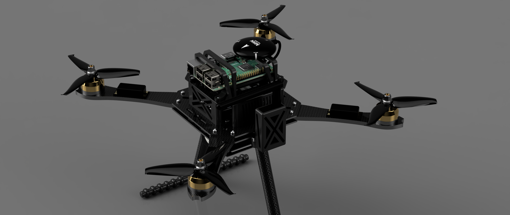
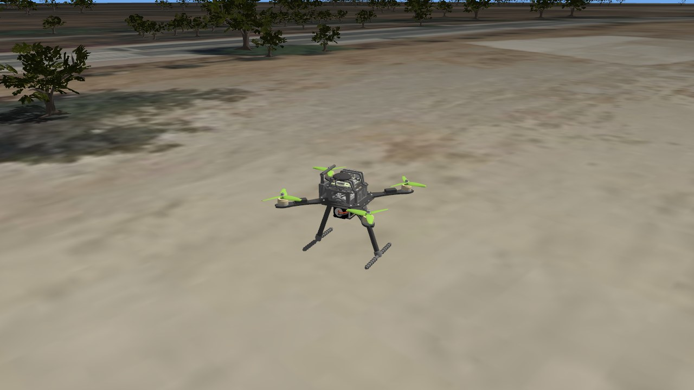
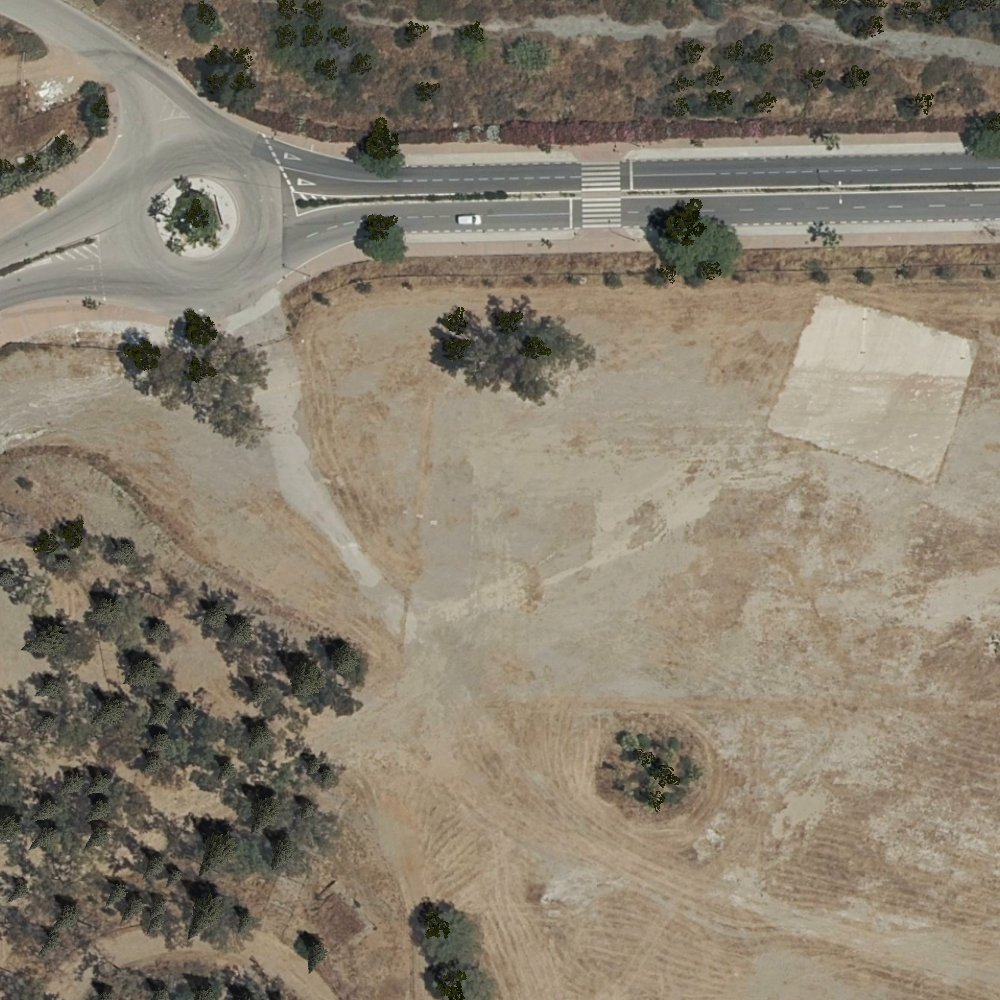
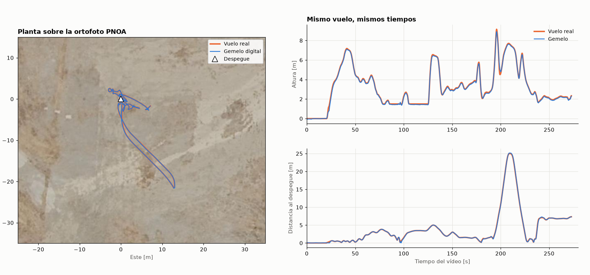
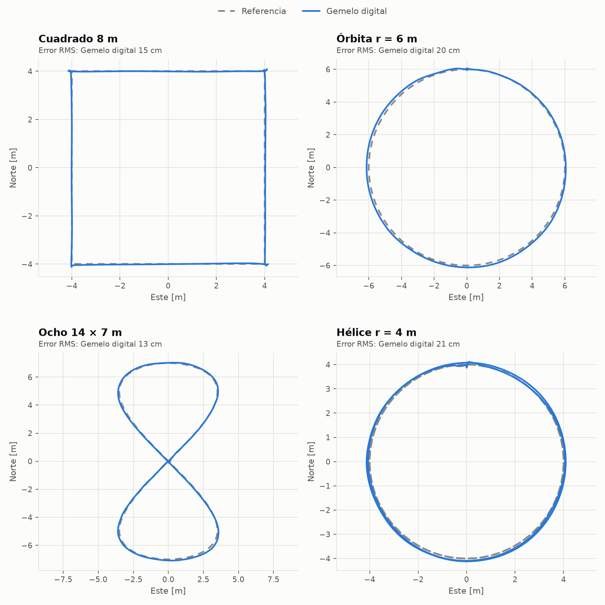

# Design and Control of an Autonomous UAV and its Digital Twin

**Final Degree Project (TFG)**, completed in September 2026

<table>
<tr><td><b>Author</b></td><td>Antonio Montero Díaz</td></tr>
<tr><td><b>Degree</b></td><td>BSc in Electronic, Robotics and Mechatronics Engineering</td></tr>
<tr><td><b>Specialisation</b></td><td>Control</td></tr>
<tr><td><b>University</b></td><td>University of Málaga</td></tr>
<tr><td><b>Supervisor</b></td><td>Ricardo Vázquez</td></tr>
<tr><td><b>Status</b></td><td>Completed (September 2026)</td></tr>
</table>

---

This project implements an autonomous drone control system using the PX4 Autopilot flight stack and MAVSDK Python SDK. It demonstrates programmatic drone control including takeoff, landing, and offboard velocity-based flight maneuvers.



## Table of Contents

- [Project Overview](#project-overview)
- [System Architecture](#system-architecture)
- [Digital Twin Parameters](#digital-twin-parameters)
- [Prerequisites](#prerequisites)
- [Installation](#installation)
- [Project Structure](#project-structure)
- [Usage](#usage)
- [Flight Scripts](#flight-scripts)
- [References](#references)

## Project Overview

This project explores autonomous drone navigation through software-in-the-loop (SITL) simulation. The system integrates:

- **PX4 Autopilot**: Open-source flight control software providing low-level flight control, state estimation, and safety features
- **MAVSDK**: High-level Python SDK for drone communication via MAVLink protocol
- **QGroundControl**: Ground control station for real-time monitoring and configuration

The implemented flight scripts demonstrate:
- Autonomous takeoff and landing sequences
- Offboard control mode with velocity-based navigation
- Real-time telemetry monitoring (altitude, flight mode, position)
- Asynchronous task management for concurrent operations

## System Architecture

```
┌─────────────────────────────────────────────────────────────────┐
│                    Ground Control Station                       │
│                      (QGroundControl)                           │
└─────────────────────────────────────────────────────────────────┘
                              │ MAVLink
                              ▼
┌─────────────────────────────────────────────────────────────────┐
│                      PX4 Autopilot (SITL)                       │
│  ┌─────────────┐  ┌─────────────┐  ┌─────────────────────────┐  │
│  │  Commander  │  │    EKF2     │  │  Position Controller    │  │
│  │  (State)    │  │ (Estimator) │  │  (mc_pos_control)       │  │
│  └─────────────┘  └─────────────┘  └─────────────────────────┘  │
│                         uORB Messaging                          │
└─────────────────────────────────────────────────────────────────┘
                              │ MAVLink (UDP:14540)
                              ▼
┌─────────────────────────────────────────────────────────────────┐
│                   MAVSDK Python Application                     │
│  ┌─────────────┐  ┌─────────────┐  ┌─────────────────────────┐  │
│  │   Action    │  │  Telemetry  │  │       Offboard          │  │
│  │ (arm/land)  │  │ (position)  │  │  (velocity control)     │  │
│  └─────────────┘  └─────────────┘  └─────────────────────────┘  │
└─────────────────────────────────────────────────────────────────┘
```

### Communication Protocols

| Interface | Protocol | Port | Purpose |
|-----------|----------|------|---------|
| MAVSDK ↔ PX4 | MAVLink over UDP | 14540 | Flight commands and telemetry |
| QGC ↔ PX4 | MAVLink over UDP | 14550 | Ground station monitoring |
| PX4 Internal | uORB | N/A | Inter-module publish-subscribe |

## Digital Twin Parameters

The Gazebo model `mi_drone` (in [`simulation/models/`](simulation/models)) uses the parameters of the real drone. Masses and inertia come from [`simulation/tools/mass_model.py`](simulation/tools/mass_model.py), a lumped-mass model that places every component at its CAD position:

```bash
python3 simulation/tools/mass_model.py
```

| Parameter | Value | Source |
|-----------|-------|--------|
| Total mass | 0.970 kg | Scale (battery and props on) |
| Battery | 0.200 kg | Scale (Tattu 4S 2200 mAh 45C) |
| Rotor (motor + nut + prop) | 0.033 kg × 4 | Scale |
| Body (`base_link`) | 0.838 kg, CoM (−1.3, 2.3, −8.7) mm | 0.970 − 4 × 0.033 |
| Vehicle inertia Ixx / Iyy / Izz | 0.0056 / 0.0052 / 0.0075 kg·m² | Lumped-mass model |
| Motor positions | (±122.8, ±122.8) mm, 347 mm diagonal | CAD mesh, matches drawings (125 mm plates, 117 mm arms) |
| Propeller | DALPROP Cyclone T5050C, 5" tri-blade | Rotor inertia Izz = 8.6e-6 kg·m² |
| Motor | Racerstar BR2205 2300KV, 4S | Component spec |
| Max thrust per motor | ~950 g (9.32 N) | Manufacturer data (5045 prop, 14.8 V) |
| Max motor speed | 2700 rad/s | 2300 KV × 14.8 V, ~76 % under load |
| Motor constant | 1.278e-6 N/(rad/s)² | T_max / ω_max² |
| Thrust / weight | 3.9 | 37.3 N / 9.5 N |
| Hover throttle | 0.419 (predicted) / 0.420 (SITL estimate) | m·g/4 = k·ω² |

## Prerequisites

### System Requirements

- **Operating System**: Ubuntu 24.04 LTS (native or WSL2 on Windows 11)
- **Simulator**: Gazebo Harmonic (gz-sim 8), installed by the PX4 setup script
- **Python**: 3.12 (Ubuntu 24.04 default)
- **RAM**: 8 GB minimum (16 GB recommended for Gazebo simulation)
- **Disk Space**: ~5 GB for PX4 and dependencies

### Required Software

- Git
- Python 3 with pip
- Build tools (gcc, g++, make, cmake)

## Installation

### 1. Clone this Repository

```bash
git clone https://github.com/MontyC0de/AUTONOMUS_DRONE_PX4_SELF_DESIGN.git
cd AUTONOMUS_DRONE_PX4_SELF_DESIGN
```

### 2. Initialize PX4-Autopilot Submodule

The PX4 flight stack is included as a git submodule. After cloning this repository, initialize and update the submodule:

```bash
git submodule update --init --recursive
```

**About submodules:** PX4-Autopilot is tracked at a specific commit of the [MontyC0de/PX4-Autopilot](https://github.com/MontyC0de/PX4-Autopilot) fork, ensuring reproducibility. To update it to the latest commit of the fork's `dev` branch:

```bash
git submodule update --remote PX4-Autopilot
git add PX4-Autopilot
git commit -m "chore: update px4-autopilot submodule"
```

### 3. Install PX4 Dependencies

```bash
cd PX4-Autopilot
bash ./Tools/setup/ubuntu.sh
```

This script installs all necessary dependencies including:
- ARM GCC toolchain
- Gazebo Harmonic simulator
- Required Python packages

### 4. Set Up Python Virtual Environment

```bash
cd ..  # Return to the repository root
python3 -m venv mavsdk-env
source mavsdk-env/bin/activate
pip install -r requirements.txt
```

### 5. Link the Drone Model into PX4

PX4 loads Gazebo models from `PX4-Autopilot/Tools/simulation/gz/models`, which belongs to the official `PX4-gazebo-models` repository. The `mi_drone` models live in this repo under `simulation/models` and are symlinked in:

```bash
./scripts/setup_sim.sh
```

The airframe `4022_gz_mi_drone` is part of the [MontyC0de/PX4-Autopilot](https://github.com/MontyC0de/PX4-Autopilot) fork (`dev` branch).

### 6. Build PX4 SITL

```bash
cd PX4-Autopilot
make px4_sitl_default
```

## Project Structure

```
AUTONOMUS_DRONE_PX4_SELF_DESIGN/
├── README.md                 # This file
├── .gitignore                # Git ignore rules
├── .gitmodules               # Git submodule configuration
│
├── PX4-Autopilot/            # PX4 flight stack (git submodule)
│   ├── src/modules/          # Flight control modules
│   ├── src/drivers/          # Hardware drivers
│   ├── ROMFS/                # Runtime filesystem
│   └── Tools/                # Build and setup tools
│
├── simulation/
│   ├── models/mi_drone/      # Motor plugins (BR2205 thrust model)
│   ├── models/mi_drone_base/ # Mass, inertia, collisions, sensors, CAD meshes
│   ├── models/campo_pruebas/ # Real test site: orthophoto ground and 3D trees
│   ├── worlds/               # campo_pruebas.sdf (georeferenced at the takeoff point)
│   └── tools/                # mass_model.py, decimate_frame.py, campo_pruebas.py
│
├── scripts/
│   └── setup_sim.sh          # Links the models into the PX4 tree
│
├── mavsdk_commands/          # Python flight control scripts
│   ├── vuelo_basico.py       # Basic takeoff/landing demo
│   ├── vuelo_01.py           # Offboard velocity control demo
│   ├── mision_avanzada.py    # Square, orbit, figure-eight and helix mission
│   ├── replay_trayectoria.py # Replays a timed trajectory (e.g. the real flight)
│   └── graficas_vuelo.py     # Plots and tracking metrics from a mission log
│
├── vuelos/                   # Mission telemetry (CSV) and generated plots
│
├── Design/                   # CAD renders and frame assembly video
│
├── mavsdk-env/               # Python virtual environment (not tracked)
│
└── QGroundControl-x86_64.AppImage  # Ground control station (not tracked)
```

## Usage

### Starting the Simulation Environment

**Terminal 1 - Start PX4 SITL with Gazebo and the drone's digital model:**

```bash
cd PX4-Autopilot
make px4_sitl gz_mi_drone
```

Wait until you see `INFO  [commander] Ready for takeoff!` in the console.

Closer follow camera (useful for recordings):

```bash
PX4_GZ_FOLLOW_OFFSET_X=-0.9 PX4_GZ_FOLLOW_OFFSET_Y=-0.9 PX4_GZ_FOLLOW_OFFSET_Z=0.5 make px4_sitl gz_mi_drone
```

**Terminal 2 - Run Flight Script:**

```bash
source mavsdk-env/bin/activate
python mavsdk_commands/vuelo_basico.py
```

**Optional - Ground Control Station:**

```bash
./QGroundControl-x86_64.AppImage
```

### Test-Site World

The world `campo_pruebas` reproduces the field where the real drone flies (takeoff point 36°30'42.4"N 4°41'45.3"W, 20 m AMSL): the world origin is the takeoff point, so PX4 and QGroundControl place the twin at the real GPS coordinates, and the magnetic field is the WMM2025 value for the site.

- Ground: PNOA orthophoto, 204.8 m at 10 cm/px plus 1.6 km of context at 80 cm/px
- Trees: oaks, eucalyptus and shrubs (Gazebo Fuel, CC0) placed over the canopies in the orthophoto

```bash
cd PX4-Autopilot
PX4_GZ_WORLD=campo_pruebas make px4_sitl gz_mi_drone
```

| Follow camera | Top view (origin = takeoff point) |
|---|---|
|  |  |

*Orthophoto: PNOA cedido por © Instituto Geográfico Nacional ([CC BY 4.0](https://creativecommons.org/licenses/by/4.0/)).*

### Test Flight

A test flight at the test site was recorded on video. Its trajectory was obtained from the recording and reproduced in the digital twin with the same timing, so both can be compared side by side.

```bash
python mavsdk_commands/replay_trayectoria.py vuelos/real_20250831/trayectoria_video.csv
```



<details>
<summary>Camera view from the recording position</summary>

```bash
gz service -s /gui/move_to/pose --reqtype gz.msgs.GUICamera --reptype gz.msgs.Boolean --timeout 3000 \
  --req "pose: {position: {x: 1.03, y: 3.35, z: 1.27}, orientation: {w: 0.5687, x: 0.1390, y: 0.0982, z: -0.8047}}"
gz topic -t /gui/track -m gz.msgs.CameraTrack -p "track_mode: TRACK, track_target: {name: 'mi_drone_0'}, track_pgain: 0.3"
```
</details>

### Simulation Without Graphics

For faster testing without the Gazebo GUI:

```bash
HEADLESS=1 make px4_sitl gz_mi_drone
```

## Flight Scripts

### vuelo_basico.py - Basic Flight Demo

Demonstrates fundamental autonomous flight operations:

1. Connects to PX4 SITL via UDP
2. Waits for GPS lock and home position
3. Arms the vehicle
4. Takes off to 10 meters altitude
5. Hovers for 10 seconds
6. Lands autonomously

**Features:**
- Concurrent telemetry monitoring (altitude, flight mode)
- Graceful task termination on landing
- Connection state verification

### vuelo_01.py - Offboard Velocity Control

Demonstrates offboard mode with velocity setpoints:

1. Connects, arms and takes off to 5 m
2. Enters offboard control mode
3. Executes a 5 m square using NED velocity commands at 1 m/s:
   - North (forward) for 5 seconds
   - East (right) for 5 seconds
   - South (backward) for 5 seconds
   - West (left) for 5 seconds
4. Stops, lands and waits until on the ground

**Key Concepts:**
- `VelocityNedYaw`: Velocity setpoint in North-East-Down frame
- Offboard mode requires continuous setpoint streaming
- Initial setpoint must be sent before starting offboard mode

### mision_avanzada.py - Autonomous Demonstration Mission

A 3.5-minute mission built for the digital twin and the real drone alike: every coordinate is relative to the takeoff point (NED), so the same script runs in SITL and on the Raspberry Pi.

| Segment | Shape | Yaw |
|---------|-------|-----|
| Square | 8 m side, stops and turns at each corner | Facing the direction of travel |
| Orbit | 6 m radius around the takeoff point | Pointing at the centre (inspection) |
| Figure-eight | Gerono lemniscate, 14 × 7 m | Tangent to the path |
| Helix | 4 m radius, 2 turns, climbing 5 → 9 m | Tangent to the path |
| Return | Back over the takeoff point, descend to 1.5 m, land | North |

**Trajectory generation.** Each segment is a curve P(θ) traversed with a minimum-jerk time law s(τ) = 10τ³ − 15τ⁴ + 6τ⁵, so it starts and ends with zero velocity and acceleration. The duration is chosen so that peak speed (2 m/s), acceleration (1.5 m/s²) and yaw rate (45 °/s) stay within limits. PX4 receives position, velocity and acceleration feedforward at 20 Hz (`set_position_velocity_acceleration_ned`).

**Safety.** The mission lands if the drone leaves the geofence (15 m), climbs above the planned ceiling, or the battery drops below 30 %. If the pilot switches flight mode on the RC transmitter, the script stops sending commands immediately. Ctrl+C lands.

```bash
# Show the plan (segments, duration, range) without flying
python mavsdk_commands/mision_avanzada.py --plan

# Fly it in the digital twin
python mavsdk_commands/mision_avanzada.py

# Real drone, from the Raspberry Pi; half size and slower for the first flight
python mavsdk_commands/mision_avanzada.py --conexion serial:///dev/serial0:921600 --escala 0.5 --velocidad 1.0

# Plots and metrics (one flight, or several overlaid, e.g. twin vs real)
python mavsdk_commands/graficas_vuelo.py vuelos/mision_XXXX.csv --etiquetas "Gemelo digital"
python mavsdk_commands/graficas_vuelo.py sim.csv real.csv --etiquetas "Gemelo" "Real"
```

**Reference run in the digital twin** ([`vuelos/mision_20261030_175030`](vuelos/mision_20261030_175030)):

| Figure | Duration | RMS error | Max error | Max speed |
|--------|----------|-----------|-----------|-----------|
| Square | 45.0 s | 15 cm | 30 cm | 2.06 m/s |
| Orbit | 35.3 s | 20 cm | 36 cm | 2.09 m/s |
| Figure-eight | 58.3 s | 13 cm | 31 cm | 2.07 m/s |
| Helix | 47.3 s | 21 cm | 39 cm | 2.12 m/s |
| Whole mission | 217 s | 17 cm | 39 cm | max tilt 10° |



**Mission video.** The log of a mission in the twin ([`vuelos/mision_20261030_184004.csv`](vuelos/mision_20261030_184004.csv)) is rendered in Gazebo frame by frame, with the simulation paused, from a fixed camera at eye height 21 m from the takeoff point and from a camera following the drone. Both views are then put side by side with the plan view of the flown path (×4).

```bash
cd simulation/tools/video
python3 mundo_render.py ../../worlds/campo_pruebas.sdf /tmp/render.sdf
# other terminal: start the render world headless
#   cd PX4-Autopilot/build/px4_sitl_default/rootfs && . ./gz_env.sh
#   GZ_SIM_RESOURCE_PATH=$GZ_SIM_RESOURCE_PATH:<repo>/simulation/tools/video/modelos_render gz sim -s --headless-rendering /tmp/render.sdf
python3 poses_mision.py ../../../vuelos/mision_20261030_184004.csv fija.csv 4 fija
python3 poses_mision.py ../../../vuelos/mision_20261030_184004.csv seguimiento.csv 4 seguimiento
python3 render_mision.py fija.csv general_fija.mp4 fija.mp4 ffmpeg
python3 render_mision.py seguimiento.csv general_seg.mp4 seguimiento.mp4 ffmpeg
python3 montaje_mision_doble.py fija.csv fija.mp4 seguimiento.mp4 mision.mp4 ffmpeg <folder with Inter-300/400/500.ttf>
```

## Development

### PX4 Build Commands

```bash
# SITL simulation build
make px4_sitl_default

# Build and run with Gazebo and mi_drone
make px4_sitl gz_mi_drone

# Clean build artifacts
make clean

# Run unit tests
make tests

# Code style check
make check_format
```

### Creating New Flight Scripts

```python
import asyncio
from mavsdk import System

async def run():
    drone = System()
    await drone.connect(system_address="udpin://0.0.0.0:14540")

    # Wait for connection
    async for state in drone.core.connection_state():
        if state.is_connected:
            break

    # Your flight logic here
    await drone.action.arm()
    await drone.action.takeoff()
    # ...

if __name__ == "__main__":
    asyncio.run(run())
```

## References

### Documentation

- [PX4 User Guide](https://docs.px4.io/main/en/)
- [PX4 Developer Guide](https://docs.px4.io/main/en/development/development.html)
- [MAVSDK Python Documentation](https://mavsdk.mavlink.io/main/en/python/)
- [MAVLink Protocol](https://mavlink.io/en/)

### Related Projects

- [PX4-Autopilot](https://github.com/PX4/PX4-Autopilot) - Flight control stack
- [MAVSDK](https://github.com/mavlink/MAVSDK) - MAVLink SDK
- [QGroundControl](http://qgroundcontrol.com/) - Ground control station

---

## About

This project was developed as a Final Degree Project (TFG) at the University of Málaga (September 2026), demonstrating autonomous drone control systems using open-source flight control software.

---

**University of Málaga** | School of Industrial Engineering

*Antonio Montero Díaz*
